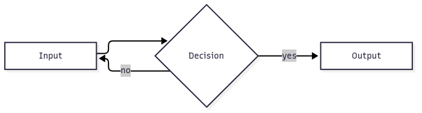

# Mermaid CLI in the Lima VM

<!-- Captured with Showboat 0.6.1 on 2026-11-12 -->
<!-- showboat-id: 1c0e53b6-8451-4d56-982f-98e12e40de4e -->

Why: The devbox VM could not render Mermaid diagrams. Agents and users had to
leave the VM to turn Mermaid diagram sources into SVG or PNG images for
documentation, design notes, or review artifacts.

What changed: The manifest-pinned `@mermaid-js/mermaid-cli` npm package is
installed in the isolated toolbuilder account. Puppeteer does not download a
duplicate Chromium: a small `mmdc` wrapper resolves the shared Playwright
chrome-for-testing binary and exports `PUPPETEER_EXECUTABLE_PATH`, so plain
`mmdc` works for the guest user. `devbox-toolchain-check` verifies the pin, and
the devbox-tools skill catalog documents when to use `mmdc`, its safe
invocation, and its fallback. The change applies on VM restart because
provisioning re-runs idempotently on every start.

## Source map

- Manifest pin: `lima/tool-versions.json:517-525`.
- Install and browser reuse: `lima/provision-tools.sh:191-246`.
- Version check: `lima/check_toolchain.py:81-84`.
- Agent guidance: `lima/agent-skills/devbox-tools/SKILL.md:98-120`.
- Unit coverage: `tests/unit/test_lima_toolchain.py:62-63,213`,
  `tests/unit/test_tool_versions.py:556`.
- VM coverage: `tests/vm/test_provisioned_vm.py:55,643-693`.

Observed in a fully provisioned fresh L2 from this worktree. The staged source
mount was read-only; config and credential mount sources were empty, and no L1
credentials were passed into the L2. The task root and L2 were deleted after
the run. Lima's hostagent log lines and the run's base64 PNG dump (used to
extract the image below) are omitted from the captured output; nothing else
changed.

```bash
limactl shell issue-487-l2 -- echo hello
limactl shell issue-487-l2 -- bash -ceu '
set -euo pipefail
source /etc/profile.d/devbox-toolchain.sh
[[ "$(cat /etc/devbox/vm-level)" == L2 ]]

task_dir="$(mktemp -d /tmp/opencode/issue-487.XXXXXXXX)"
chmod 0700 "$task_dir"
cleanup() { rm -rf -- "$task_dir"; }
trap cleanup EXIT

# The wrapper on the toolbuilder bin path must be what resolves.
command -v mmdc
[[ "$(command -v mmdc)" == /var/lib/devbox-toolbuilder/.local/bin/mmdc ]]
test -x /var/lib/devbox-toolbuilder/.local/bin/mmdc-bin
grep -q PUPPETEER_EXECUTABLE_PATH /var/lib/devbox-toolbuilder/.local/bin/mmdc

expected_version="$(jq -er ".tools.mermaid_cli.version" /etc/devbox/tool-versions.json)"
installed_version="$(mmdc --version)"
printf "issue-487 guest: mmdc version %s (manifest %s)\n" \
  "$installed_version" "$expected_version"
[[ "$installed_version" == "$expected_version" ]]

cat >"$task_dir/diagram.mmd" <<EOF
flowchart LR
    A[Input] --> B{Decision}
    B -- yes --> C[Output]
    B -- no --> A
EOF

mmdc --input "$task_dir/diagram.mmd" --output "$task_dir/diagram.svg"
grep -q "<svg" "$task_dir/diagram.svg"
test -s "$task_dir/diagram.svg"

mmdc --input "$task_dir/diagram.mmd" --output "$task_dir/diagram.png"
file -b "$task_dir/diagram.png" | grep -qi "^png image data"
test -s "$task_dir/diagram.png"
printf "issue-487 guest: rendered SVG and PNG\n"

devbox-toolchain-check >"$task_dir/toolchain.txt"
grep -q "^OK: mermaid_cli: ${expected_version}$" "$task_dir/toolchain.txt"
printf "issue-487 guest: toolchain check reports %s OK tools\n" \
  "$(grep -c "^OK:" "$task_dir/toolchain.txt")"

# Puppeteer must reuse the shared Playwright browser, not download its own.
test ! -e /var/lib/devbox-toolbuilder/.cache/puppeteer

printf "issue-487 guest: validation passed\n"
'
```

```output
hello
/var/lib/devbox-toolbuilder/.local/bin/mmdc
issue-487 guest: mmdc version 12.2.0 (manifest 12.2.0)
Generating single mermaid chart
Generating single mermaid chart
issue-487 guest: rendered SVG and PNG
issue-487 guest: toolchain check reports 40 OK tools
issue-487 guest: validation passed
```

The rendered PNG captured from that run:



## Reproduce and clean up

Follow the fresh-L2 checklist in [`lima/README.md`](../lima/README.md) and the
task-isolation recipe in [`AGENTS.md`](../AGENTS.md). Create a private
`LIMA_HOME` with a staged read-only source mount and empty config/credential
sources, then replace the recorded instance name with the new L2's name. After
readiness, confirm `limactl shell <name> -- echo hello`, stop and delete the
instance, then remove the private task root only after deletion succeeds. The
validation instance and its temporary root have already been removed.
